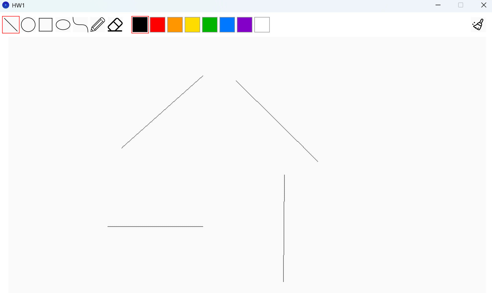
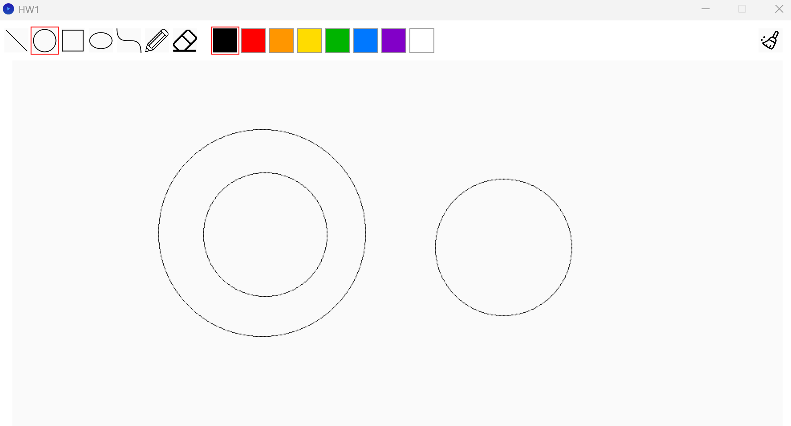
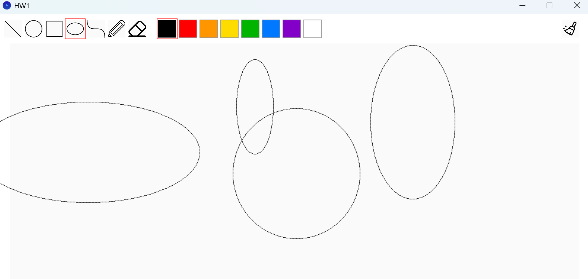
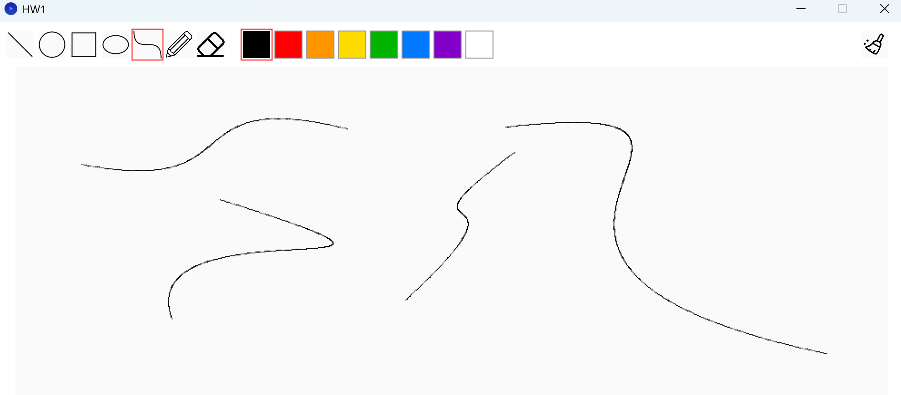
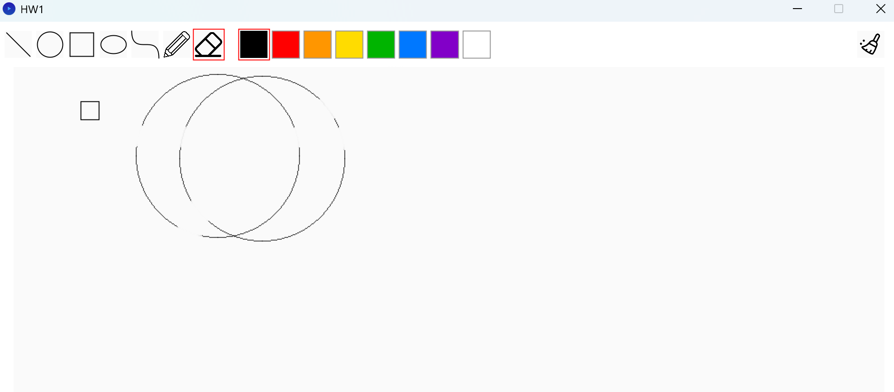
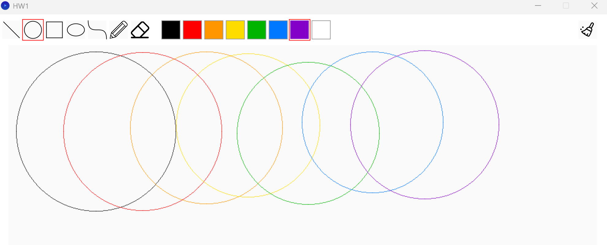

# CG HW1 - 小畫家

- 學號：112502024
- 姓名：張凱翔

## 完成項目

- [x] Line
- [x] Circle
- [x] Ellipse
- [x] Curve
- [x] Eraser
- [x] 加分：調色盤


## 實作說明

### Line：Bresenham 演算法



#### 從 DDA 開始

一開始先寫 DDA：取 `steps = max(|dx|, |dy|)`，每一步讓 x、y 各增加 `dx/steps`、`dy/steps`，畫點時再四捨五入。

#### 改成 Bresenham

先只考慮「由左往右、斜率 0～1」的線。這時 x 每步一定 +1，y 只有「不動」或「+1」兩種選擇。

用 DDA 的角度來看，可以記錄一個**誤差**（真實的線比目前畫的格子高多少）：每步誤差 `+= dy/dx`，超過 0.5 就 `y++` 並讓誤差 `-= 1`。把所有量乘上 `2·dx` 之後就全部變成整數，得到決策參數：

- 初始值 `p = 2dy − dx`
- `p < 0`：y 不動，`p += 2dy`
- `p ≥ 0`：`y++`，`p += 2dy − 2dx`

#### 推廣到所有方向

用三個技巧把任意線段轉換成上面的基本情況：

1. **太陡（|dy| > |dx|）就對調 x、y**，畫點時再換回來
2. **由右往左就對調起點和終點**
3. **往上走就讓 y 每步 −1**（`ystep`），計算 `p` 時用 `|dy|`

```java
boolean steep = abs(y2i - y1i) > abs(x2i - x1i);
if (steep) { /* 對調兩個點的 x、y */ }
if (x1i > x2i) { /* 對調起點、終點 */ }

int dx = x2i - x1i;
int dy = abs(y2i - y1i);
int ystep = (y1i < y2i) ? 1 : -1;
int p = 2 * dy - dx;
int y = y1i;
for (int x = x1i; x <= x2i; x++) {
    if (steep) drawPoint(y, x, drawColor);
    else drawPoint(x, y, drawColor);
    if (p < 0) {
        p += 2 * dy;
    } else {
        y += ystep;
        p += 2 * dy - 2 * dx;
    }
}
```

#### 發現

- **四捨五入的時機很重要**：DDA 我把「每一步的增量」拿去四捨五入，但短軸的增量一定介於 −1～1，四捨五入後只剩 0 或 ±1，結果只畫得出水平、垂直和 45° 的線。正確做法是座標用 float 累積，**只在畫點時才四捨五入**。
- **對調的順序不能相反**：要先處理「太陡就對調 x、y」，再處理「由右往左」。因為對調 x、y 之後，迴圈跑的主軸會換成原本的 y，如果先判斷左右，判斷的是錯誤的軸，迴圈可能一圈都不會跑。
- 因為 Polygon 和 Pencil 也都呼叫 `CGLine`，直線完成後這兩個工具就跟著能用了。

### Circle：中點圓演算法



#### 八分對稱

圓上下、左右、對角線都對稱，若 `(x, y)` 是相對於圓心的偏移量，則 `(±x, ±y)`、`(±y, ±x)` 共 8 個點都在圓上。所以只需要算**從正上方 `(0, r)` 到 45°** 這 1/8 圓弧。

#### 決策參數

這段弧上 x 每步 +1，y 只會「不動」或「−1」。取兩個候選格子的中點 `(x+1, y−0.5)` 代入 `f(x, y) = x² + y² − r²`：

- 中點在圓內（`p < 0`）：y 不動
- 中點在圓外：y − 1

初始值 `p = 1 − r`（由 `f(1, r−0.5) = 1.25 − r` 捨去小數），之後每步只用加法更新：

```java
int px = 0, py = R, p = 1 - R;
while (px <= py) {
    drawCirclePoints(cx, cy, px, py);
    px++;
    if (p < 0) {
        p += 2 * px + 1;
    } else {
        py--;
        p += 2 * px + 1 - 2 * py;
    }
}
```

#### 發現

- 一開始我寫的 `drawCirclePoints` 把座標當成**螢幕上的絕對座標**，用 `2·cx − x` 做鏡射。左右、上下的鏡射是對的，但對調 x、y 的那 4 個點變成以**螢幕左上角**的對角線鏡射，而不是以圓心鏡射，點會跑到奇怪的位置。改成「相對於圓心的偏移量」後 8 個點就很直觀：`drawPoint(cx ± x, cy ± y)`、`drawPoint(cx ± y, cy ± x)`。
- 中點圓演算法其實是 `y = sqrt(r² − x²)` 的加速版：它不計算平方根，而是每一步只回答「下一個點的 y 要不要往下一格」，再用整數加減更新判斷依據。

### Ellipse：中點橢圓演算法



`r1` 為水平半徑、`r2` 為垂直半徑。橢圓長短軸不同，**只有四分對稱**，所以只算第一象限的 1/4 圈，再鏡射到其他三個象限。

這 1/4 圈要**分成兩個區域**：

| 區域 | 範圍 | 主軸 | 每步決定 |
|---|---|---|---|
| 區域 1 | 正上方 → 切線斜率 = −1 | x 每步 +1 | y 要不要 −1 |
| 區域 2 | 斜率 = −1 → 正右方 | y 每步 −1 | x 要不要 +1 |

切換的條件是 `2·ry²·x ≥ 2·rx²·y`，也就是切線斜率到達 −1 的地方。如果只用區域 1 的方式畫到底，橢圓在比較陡的部分會斷開。

```java
// 區域 1
double p = ry2 - rx2 * ry + 0.25 * rx2;
while (dx < dy) {
    drawEllipsePoints(cx, cy, px, py);
    px++;
    dx += 2 * ry2;
    if (p < 0) {
        p += dx + ry2;
    } else {
        py--;
        dy -= 2 * rx2;
        p += dx - dy + ry2;
    }
}

// 區域 2
p = ry2 * (px + 0.5) * (px + 0.5) + rx2 * (py - 1) * (py - 1) - rx2 * ry2;
while (py >= 0) {
    drawEllipsePoints(cx, cy, px, py);
    py--;
    dy -= 2 * rx2;
    if (p > 0) {
        p += rx2 - dy;
    } else {
        px++;
        dx += 2 * ry2;
        p += dx - dy + rx2;
    }
}
```

#### 發現

- 決策參數的數值大約是 `rx² · ry²` 的量級，超過 `int` 的範圍，所以改用 `double` 計算。
- 其中一個半徑為 0 時，橢圓會退化成一條線段，直接用 `CGLine` 畫。

### Curve：三次 Bézier 曲線



p1、p4 為端點，p2、p3 為控制點：

$$B(t) = (1-t)^3 P_1 + 3(1-t)^2 t\, P_2 + 3(1-t) t^2 P_3 + t^3 P_4,\quad t \in [0, 1]$$

如果每個 t 只畫一個點，t 的間隔太大曲線會斷掉，太小又浪費效能。我的做法是：

1. 用**控制多邊形的總長度**（`|P1P2| + |P2P3| + |P3P4|`）估計要切幾段，每段約 2 像素。Bézier 曲線一定落在控制點的凸包內，所以曲線長度不會超過這個值。
2. 相鄰兩個取樣點用 `CGLine` 連起來，保證曲線連續不斷。

```java
float len = distance(p1, p2) + distance(p2, p3) + distance(p3, p4);
int segments = max(1, ceil(len / 2));
float prevX = p1.x, prevY = p1.y;
for (int i = 1; i <= segments; i++) {
    float t = (float) i / segments;
    float u = 1 - t;
    float curX = u*u*u * p1.x + 3*u*u*t * p2.x + 3*u*t*t * p3.x + t*t*t * p4.x;
    float curY = u*u*u * p1.y + 3*u*u*t * p2.y + 3*u*t*t * p3.y + t*t*t * p4.y;
    CGLine(prevX, prevY, curX, curY);
    prevX = curX;
    prevY = curY;
}
```

### Eraser



作業規定不能使用 `rect`，所以用兩層迴圈把 p1、p2 圍出的矩形**逐點塗成背景色 `color(250)`**。另外把範圍限制在畫布內，避免橡皮擦移到畫布邊緣時，把外面白色的邊框也塗成灰色。

```java
for (int i = left; i <= right; i++) {
    for (int j = top; j <= bottom; j++) {
        drawPoint(i, j, color(250));
    }
}
```

### 加分：調色盤



工具列右側新增 8 個色塊，點選後之後畫的圖形就會使用該顏色，已經畫好的圖形維持原本的顏色。目前選中的色塊會有比較大的外框標示。

#### 遇到的問題：畫面每一幀都會重畫

框架的 `ShapeRenderer.run()` 每一幀都會把清單中**所有畫過的圖形重畫一次**。所以如果只是把畫筆顏色改掉，下一幀重畫時舊圖形也會一起變色。

因此真正要做的是**讓每個圖形記住自己被畫出來時的顏色**。

#### 實作

1. **兩個全域顏色變數**

   ```java
   color currentColor = color(0); // 使用者在調色盤選的顏色
   color drawColor = color(0);    // CG 函式「此刻」要用的顏色
   ```

   `util.pde` 裡所有畫圖形的 `drawPoint` 都改用 `drawColor`（橡皮擦維持 `color(250)`）。這樣 CG 函式不需要知道自己正在畫哪個圖形。

2. **`Shape` 從 interface 改成 abstract class**，多一個記住顏色的欄位，所有圖形類別改成 `extends Shape`：

   ```java
   public abstract class Shape {
       color c = currentColor;   // 建立圖形的那一刻，記下當時選的顏色
       public abstract void drawShape();
   }
   ```

   欄位初始值在**物件建立的瞬間**執行，所以不用修改每個圖形的建構子，就能自動記住當時的顏色。

3. **重畫時切換顏色**

   ```java
   for (Shape s : shapes) {
       drawColor = s.c;           // 舊圖形：用它自己的顏色
       s.drawShape();
   }
   drawColor = currentColor;      // 預覽：用目前選的顏色
   if (renderer != null) renderer.render();
   ```

4. **色塊按鈕**沿用框架的 `Button` 類別，按鈕底色就是調色盤的顏色。

#### 發現

- **interface 裡的欄位會自動變成 `static`**：一開始我把 `color c = currentColor;` 直接加在 interface 裡，出現 *Cannot make a static reference to the non-static field currentColor* 的錯誤。因為 interface 的欄位是所有實作類別共用的常數，就算能編譯，所有圖形也會共用同一個顏色。改成 abstract class 後，每個圖形物件才有自己的 `c`。
- **lambda 只能使用 final 的變數**：在迴圈裡建立按鈕的 callback 時，不能直接使用會變動的 `palette[i]`，要先存到 `final color c = palette[i];` 再在 lambda 裡使用。
- **Processing 的畫筆設定是全域的**：`stroke()`、`strokeWeight()` 會一直保留到下次修改。畫色塊外框時如果改了 `strokeWeight` 卻沒改回來，後面 `drawPoint` 畫的所有線都會一起變粗。

## 心得

做調色盤時發現框架每一幀都會重畫所有圖形，一開始我以為畫完的圖形會直接「印」在畫板上。整理後發現兩種做法各有取捨：

| | 每幀全部重畫（本框架） | 畫完就印在畫板上 |
|---|---|---|
| 記錄的是 | 圖形清單（端點、顏色） | 像素（一張圖片） |
| 復原（Z） | 刪掉清單最後一個即可 | 要另外存畫之前的圖片 |
| 預覽線 | 每幀清空重畫，很簡單 | 不能直接畫在畫板上，否則會留下殘影 |
| 效能 | 圖形越多越慢 | 跟畫了多少無關 |

本框架選擇前者，換來的是預覽和復原都非常容易實作。代價在橡皮擦上最明顯：拖曳時**每一幀都會新增一個 `EraseArea`**，而且 `drawPoint` 是一個像素呼叫一次，擦久了清單變長，畫面就會開始變慢。一般的點陣小畫家通常採用後者，或是兩者混合：已完成的圖形畫到暫存圖片上，只有預覽每幀重畫。

## LLM 使用說明

本次作業使用 Claude作為學習輔助，主要以一步一步引導的方式進行。

由claude提出思路及簡約程式碼框架，由我撰寫完成後測試，如果遇到問題再向AI求助解決方法，並在實作過程中釐清觀念。
